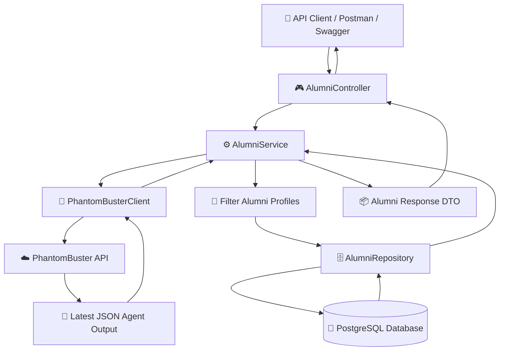
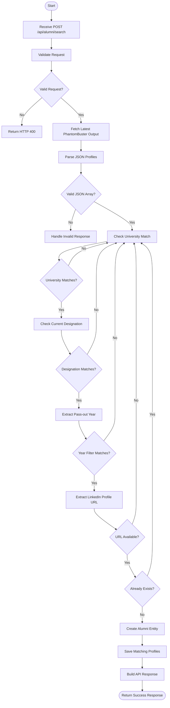
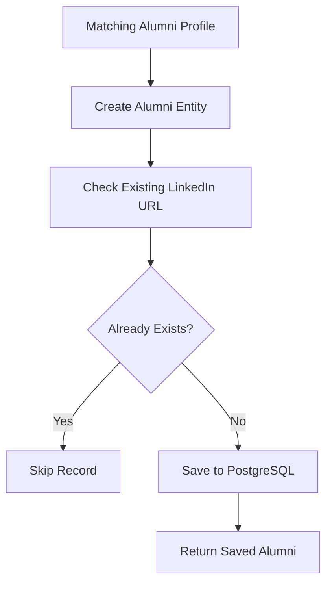

# 🎓 Alumni LinkedIn Profile Searcher

<p align="center">

  **A Spring Boot REST API for discovering and managing university alumni profiles.**

  Integrates PhantomBuster with PostgreSQL to retrieve, filter, and store alumni information based on university, current designation, and graduation year.

</p>

<p align="center">

  
  
  
  
  
  

</p>

---

## 📌 Project Overview

The **Alumni LinkedIn Profile Searcher** is a backend application developed using Java and Spring Boot.

It retrieves alumni profile data from the latest available PhantomBuster agent output, filters profiles according to user-provided criteria, and stores matching records in a PostgreSQL database.

The application exposes REST APIs that allow users to search alumni and retrieve previously saved profiles.

### 🎯 Key Objectives

- Discover alumni profiles associated with a particular university.
- Filter alumni by their current job designation.
- Optionally filter alumni by graduation year.
- Retrieve profile information through PhantomBuster.
- Store alumni information in PostgreSQL.
- Prevent duplicate LinkedIn profile records.
- Provide structured REST API responses.

---

## ✨ Features

| Feature | Description |
|---|---|
| 🔍 Alumni Search | Search profiles based on university |
| 💼 Designation Filter | Match current job designations |
| 🎓 Pass-out Year Filter | Optional graduation-year filtering |
| 🔗 PhantomBuster Integration | Retrieve the latest available agent output |
| 🗄️ PostgreSQL Storage | Persist alumni information |
| ♻️ Duplicate Prevention | Avoid saving existing LinkedIn profile URLs |
| ⚠️ Global Exception Handling | Consistent error responses |
| 📖 Swagger Documentation | Interactive REST API documentation |
| 🧪 Unit Testing | JUnit 5 and Mockito |

---

## 🛠️ Technology Stack

| Technology | Usage |
|---|---|
| Java 25 | Backend programming |
| Spring Boot 4 | Application framework |
| Spring WebMVC | REST API development |
| Spring Data JPA | Database operations |
| PostgreSQL 18 | Relational database |
| PhantomBuster API | Alumni profile data retrieval |
| Jackson | JSON processing |
| Maven | Dependency management |
| JUnit 5 | Unit testing |
| Mockito | Mocking dependencies |
| Swagger / OpenAPI | API documentation |

---

# 🏗️ System Architecture

The application follows a layered architecture to separate responsibilities and improve maintainability.



### Architecture Responsibilities

| Layer | Responsibility |
|---|---|
| Controller | Handles incoming HTTP requests |
| Service | Implements alumni search and filtering logic |
| Client | Communicates with PhantomBuster |
| Repository | Performs database operations |
| Entity | Represents alumni database records |
| DTO | Defines API request and response structures |
| Exception | Handles application errors globally |
| Config | Configures external API communication |

---

# 🔄 Application Workflow

The following diagram explains how an alumni search request is processed.



---

# 📁 Project Structure

```text
alumni-searcher/
│
├── src/
│   ├── main/
│   │   ├── java/
│   │   │   └── com/freightfox/alumni_searcher/
│   │   │       │
│   │   │       ├── client/
│   │   │       │   └── PhantomBusterClient.java
│   │   │       │
│   │   │       ├── config/
│   │   │       │   └── RestClientConfig.java
│   │   │       │
│   │   │       ├── controller/
│   │   │       │   └── AlumniController.java
│   │   │       │
│   │   │       ├── dto/
│   │   │       │   ├── AlumniSearchRequest.java
│   │   │       │   ├── AlumniSearchResponse.java
│   │   │       │   └── AlumniResponse.java
│   │   │       │
│   │   │       ├── entity/
│   │   │       │   └── Alumni.java
│   │   │       │
│   │   │       ├── exception/
│   │   │       │   └── GlobalExceptionHandler.java
│   │   │       │
│   │   │       ├── repository/
│   │   │       │   └── AlumniRepository.java
│   │   │       │
│   │   │       ├── service/
│   │   │       │   └── AlumniService.java
│   │   │       │
│   │   │       └── AlumniSearcherApplication.java
│   │   │
│   │   └── resources/
│   │       └── application.properties
│   │
│   └── test/
│       └── java/
│           └── com/freightfox/alumni_searcher/
│               └── service/
│                   └── AlumniServiceTest.java
│
├── pom.xml
├── mvnw
├── mvnw.cmd
└── README.md
```

---

# 🔌 REST API Documentation

Base URL:

```text
http://localhost:8080
```

## 1. Search Alumni

**Endpoint:** `POST /api/alumni/search`

Searches for alumni based on university and current designation. Pass-out year is optional.

### Request Body

```json
{
  "university": "Sambhram Institute of Technology",
  "designation": "Software Engineer",
  "passoutYear": 2021
}
```

You can omit `passoutYear` if you don't want to filter by graduation year.

### Successful Response

**HTTP Status:** `200 OK`

```json
{
  "status": "success",
  "data": [
    {
      "name": "Example Alumni",
      "currentRole": "Software Engineer",
      "university": "Sambhram Institute of Technology",
      "location": "Bengaluru",
      "linkedinHeadline": "Software Engineer",
      "passoutYear": 2021
    }
  ]
}
```

If no new matching profiles are found, the API returns:

```json
{
  "data": [],
  "status": "success"
}
```

## 2. Get All Alumni

**Endpoint:** `GET /api/alumni/all`

Retrieves all alumni records stored in PostgreSQL.

### Successful Response

**HTTP Status:** `200 OK`

```json
[
  {
    "id": 1,
    "name": "Example Alumni",
    "currentRole": "Software Engineer",
    "university": "Sambhram Institute of Technology",
    "location": "Bengaluru",
    "linkedinHeadline": "Software Engineer",
    "passoutYear": 2021,
    "linkedinProfileUrl": "https://linkedin.com/in/example"
  }
]
```

---

# ⚠️ Exception Handling

The application uses Spring Boot's `@RestControllerAdvice` for centralized exception handling.

| Exception | HTTP Status | Description |
|---|---:|---|
| MethodArgumentNotValidException | 400 | Invalid request fields |
| HttpMessageNotReadableException | 400 | Malformed JSON |
| IllegalArgumentException | 400 | Invalid argument |
| DataIntegrityViolationException | 409 | Database constraint violation |
| Exception | 500 | Unexpected server error |

### Example Validation Error

```json
{
  "timestamp": "2026-11-15T01:45:58",
  "status": 400,
  "error": "Bad Request",
  "message": "university: University name is required"
}
```

---

# 🗄️ Database Design

The application uses PostgreSQL to store alumni profile information.

### Alumni Entity

| Column | Description |
|---|---|
| id | Primary key |
| name | Alumni full name |
| current_designation | Current job role |
| university | University name |
| location | Current location |
| linkedinHeadline | LinkedIn headline |
| passoutYear | Graduation year |
| linkedin_profile_url | LinkedIn profile URL |

### Database Workflow



A unique database constraint on the LinkedIn profile URL provides an additional safeguard against duplicate records.

---

# ⚙️ Installation and Setup

## Prerequisites

Install the following:

- Java JDK 25
- Spring Tool Suite or IntelliJ IDEA
- PostgreSQL 18
- Maven
- PhantomBuster account and configured agent

## Step 1: Clone the Repository

```bash
git clone YOUR_GITHUB_REPOSITORY_URL
```

```bash
cd alumni-searcher
```

Replace the repository placeholder with your actual GitHub URL.

## Step 2: Create PostgreSQL Database

Open PostgreSQL and execute:

```sql
CREATE DATABASE alumni_db;
```

## Step 3: Configure Application Properties

Open:

`src/main/resources/application.properties`

Configure:

```properties
spring.application.name=alumni-searcher

spring.datasource.url=jdbc:postgresql://localhost:5432/alumni_db
spring.datasource.username=${DB_USERNAME}
spring.datasource.password=${DB_PASSWORD}

spring.jpa.hibernate.ddl-auto=update
spring.jpa.show-sql=true
spring.jpa.properties.hibernate.format_sql=true

server.port=8080

phantombuster.api-key=${PHANTOMBUSTER_API_KEY}
phantombuster.agent-id=${PHANTOMBUSTER_AGENT_ID}
```

Set the required environment variables:

- `DB_USERNAME`
- `DB_PASSWORD`
- `PHANTOMBUSTER_API_KEY`
- `PHANTOMBUSTER_AGENT_ID`

**Security:** Never commit database credentials or PhantomBuster API keys to GitHub.

## Step 4: Run the Application

Run the main class:

`AlumniSearcherApplication.java`

Alternatively, use the Maven wrapper:

```bash
./mvnw spring-boot:run
```

On Windows:

```bash
mvnw.cmd spring-boot:run
```

Application URL:

`http://localhost:8080`

---

# 📖 Swagger API Documentation

After starting the application, open:

**http://localhost:8080/swagger-ui/index.html**

Swagger provides an interactive interface to:

- View available API endpoints.
- Understand request and response formats.
- Execute POST requests.
- Test GET requests.
- Inspect HTTP status codes.

---

# 🧪 Testing

The project uses JUnit 5 and Mockito for unit testing.

### Test Coverage

| Test Case | Purpose |
|---|---|
| shouldSaveMatchingAlumni | Checks matching alumni are saved |
| shouldSkipExistingAlumni | Checks duplicate prevention |
| shouldFilterByPassoutYear | Checks graduation-year filtering |
| shouldRejectInvalidPhantomBusterResponse | Checks invalid external data handling |
| shouldReturnAllSavedAlumni | Checks retrieval of saved alumni |

### Running Tests

Run `AlumniServiceTest.java` as a JUnit test from your IDE, or use:

```bash
./mvnw test
```

---

# 🔐 Security Considerations

- API keys are configured through environment variables.
- Database credentials should not be committed to source control.
- PhantomBuster API authentication is handled through the configured HTTP client.
- The external JSON result is downloaded using a separate HTTP client without the PhantomBuster authentication header.
- LinkedIn profile URLs are protected by a database uniqueness constraint.

---

# 🚀 Future Enhancements

- Dynamically launch PhantomBuster agent runs for each search request.
- Add pagination and sorting to alumni retrieval.
- Support additional search filters.
- Add integration tests for controller and database layers.
- Introduce structured logging and monitoring.
- Improve resilience with retry and timeout handling.

---

# 👨‍💻 Project Information

**Project Name:** Alumni LinkedIn Profile Searcher

**Assignment:** FreightFox Backend Assignment

**Category:** Backend Development / REST API

**Primary Language:** Java

**Framework:** Spring Boot

---

<p align="center">

  **Built with Java, Spring Boot and PostgreSQL.**

  🎓 Turning alumni discovery into a structured backend service.

</p>